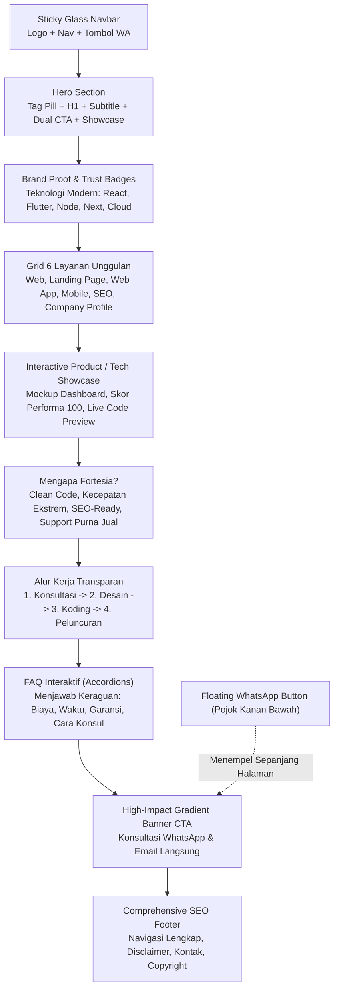

# 🚀 Blueprint & Rencana Eksekusi: Landing Page Fortesia Tech Innovation

Dokumen ini merupakan cetak biru (*blueprint*) komprehensif untuk pengembangan landing page **Fortesia Tech Innovation**. Rencana ini dirancang secara terukur untuk:
1. **Bebas Halusinasi & Anti-AI Slop**: Copywriting manusiawi, tajam, berorientasi konversi, dan bebas dari jargon klise.
2. **SEO-Friendly Standar Google Indonesia**: Mengintegrasikan riset kata kunci volume tinggi dan intensi transaksional.
3. **Presisi Desain Sesuai Referensi**: Mengadaptasi tema *dark modern SaaS/tech studio* (neon violet/indigo, glassmorphism, card glow, clean dashboard showcase) dari desain referensi ke identitas Fortesia.
4. **Performa Ekstrem (Lightweight & Responsive)**: Waktu muat < 1 detik, Core Web Vitals hijau (skor 95-100), dan 100% mobile-friendly tanpa dependensi berlebih.
5. **Konversi Tanpa Tabel Harga**: Mengarahkan seluruh calon klien korporat, startup, maupun UMKM langsung ke konsultasi interaktif via WhatsApp (`+62 858-9386-1418`) dan Email resmi.

---

## 1. Identitas Brand & Konsep Visual

### 1.1 Profil Bisnis
* **Nama Perusahaan:** **Fortesia Tech Innovation**
* **Bidang Usaha:** Software House & Digital Engineering Agency
* **Layanan Utama:**
  1. Jasa Pembuatan Website & Web Portal
  2. Jasa Pembuatan Landing Page Konversi Tinggi
  3. Pengembangan Custom Web Application (Dashboard, ERP, CRM, SaaS)
  4. Pembuatan Aplikasi Mobile (Android & iOS — Cross Platform & Native)
  5. Jasa Optimasi Mesin Pencari (SEO On-Page, Off-Page, Technical)
  6. Jasa Pembuatan Website Company Profile Perusahaan / Korporat
* **Kontak Utama:**
  * **WhatsApp Konsultasi:** `+62 858-9386-1418` (Direct API: `https://wa.me/6285893861418`)
  * **Email Resmi:** `halo@fortesiatech.com` / `contact@fortesiatech.id`
* **Strategi Penetapan Harga:** *Custom Tailored Consultation* (Tanpa label harga kaku; setiap proyek dinilai berdasarkan kebutuhan arsitektur dan skala bisnis melalui sesi konsultasi gratis).

### 1.2 Konsep Logo Fortesia Tech Innovation
Karena logo resmi belum tersedia, kami mendesain logo kustom berbasis vektor SVG murni:
* **Simbol:** Monogram futuristik perpaduan huruf **"F"** dan bentuk perisai (*Shield/Hexagon Node*) dengan simpul sirkuit digital.
* **Makna Filosofis:**
  * *Hexagon/Shield:* Keamanan, stabilitas arsitektur kode, dan ketangguhan sistem.
  * *Tech Node:* Inovasi teknologi, konektivitas, dan modernitas.
* **Warna Logo:** Gradien neon *Electric Violet* (`#8B5CF6`) ke *Vibrant Indigo* (`#6366F1`) dan aksen *Cyan Glow* (`#38BDF8`).

### 1.3 Adaptasi Desain Referensi (Nexora Dark Theme)
Berdasarkan screenshot referensi yang diunggah:
* **Background Canvas:** Deep Obsidian (`#08070E` hingga `#0D0C1D`) dengan *ambient radial mesh glow* ungu tua di latar belakang.
* **Card Containers:** Dark Frosted Glass (`rgba(19, 18, 38, 0.7)`), backdrop-blur 12px, border halus 1px (`rgba(255, 255, 255, 0.08)`), dan *hover glow border* (`#8B5CF6`).
* **Tipografi:** Sans-serif modern dan tegas (Inter / Plus Jakarta Sans), kontras tinggi, keterbacaan tajam di layar ponsel OLED/LCD.
* **Aksen Warna & Status:**
  * Primary Neon: Violet Indigo (`#6366f1` - `#8b5cf6`)
  * Secondary Highlight: Electric Cyan (`#06b6d4` / `#38bdf8`)
  * Success / Active State: Emerald Tech (`#10b981`)
  * Text Heading: Putih Kristal (`#F8FAFC`)
  * Text Muted Body: Slate Silver (`#94A3B8`)

---

## 2. Riset Kata Kunci SEO Indonesia & Arsitektur On-Page

Riset ini membagi kata kunci ke dalam **Search Intent** agar mendatangkan calon klien yang siap bayar (*High-Converting Traffic*), bukan sekadar pencari materi tutorial gratis.

### 2.1 Pemetaan Kata Kunci Utama (High Intent / Transactional)

| Kategori Layanan | Kata Kunci Target (Indonesia) | Intensi Pencarian | Target Penempatan di Halaman |
| :--- | :--- | :--- | :--- |
| **Website & Profil** | `jasa pembuatan website perusahaan`, `jasa bikin company profile profesional`, `jasa web developer indonesia` | Transaksional / Komersial | Hero H1, Layanan Card 1 & 6, Meta Tag |
| **Landing Page** | `jasa pembuatan landing page cepat`, `jasa landing page konversi tinggi`, `bikin landing page umkm dan bisnis` | Transaksional | Layanan Card 2, Section Showcase, Subheading |
| **Aplikasi Web** | `jasa pembuatan web app custom`, `software house pembuatan sistem web`, `developer dashboard erp crm indonesia` | Komersial Korporat | Layanan Card 3, Feature Grid, Schema Service |
| **Aplikasi Mobile** | `jasa pembuatan aplikasi mobile android ios`, `software house aplikasi mobile indonesia`, `biaya jasa bikin aplikasi mobile custom` | Transaksional Tinggi | Layanan Card 4, Interactive Showcase |
| **Optimasi SEO** | `jasa optimasi seo indonesia`, `jasa seo website garansi naik ranking`, `konsultan seo website profesional` | Transaksional / Riset | Layanan Card 5, FAQ, Value Proposition |
| **Software House** | `software house terbaik di indonesia`, `jasa it solution dan software development`, `vendor pengembang aplikasi jakarta indonesia` | Komersial / Brand | Header, Footer, Schema Organization |

### 2.2 On-Page SEO Checklist & Metadata
* **Title Tag:**  
  `Fortesia Tech Innovation | Jasa Pembuatan Website, Web App, Mobile App & SEO Indonesia` (Maks 60 karakter efektif).
* **Meta Description:**  
  `Jasa pembuatan website, landing page, aplikasi mobile iOS/Android, dan optimasi SEO profesional oleh Fortesia Tech Innovation. Sistem cepat, aman & konsultasi gratis.` (155 karakter).
* **Semantic HTML5:**  
  Struktur wajib menggunakan `<header>`, `<nav>`, `<main>`, `<section>`, `<article>`, `<aside>`, dan `<footer>`. Hanya ada **1 buah `<h1>`** di Hero Section, diikuti `<h2>` untuk setiap judul modul layanan, dan `<h3>` untuk sub-layanan.
* **Structured Data (Schema.org JSON-LD):**
  * `ProfessionalService` & `SoftwareApplication`
  * `Organization` (Logo, nomor kontak WhatsApp, alamat Indonesia)
  * `FAQPage` (Memperbesar peluang muncul di *Google Rich Snippets*)

---

## 3. Matriks Copywriting: Anti-"AI Slop" & Berorientasi Konversi

Kita membuang semua kata-kata klise robotik dan menggantinya dengan bahasa bisnis Indonesia yang lugas, terpercaya, dan menyentuh *pain point* klien nyata.

| Elemen Website | ❌ AI Slop (Klise, Hambar, Robotik) | ✅ Copy Fortesia (Lugas, Menjual, Berbobot) |
| :--- | :--- | :--- |
| **Hero Tagline** | "Di era digital yang serba cepat ini, kami menghadirkan revolusi solusi holistik untuk memberdayakan sinergi bisnis Anda." | **"Wujudkan Website Kencang & Aplikasi Andal Tanpa Ribet Masalah Teknis."** |
| **Hero Subtitle** | "Kami memanfaatkan kecanggihan teknologi mutakhir untuk membuka potensi tak terbatas pada setiap lini organisasi." | "Software house partner untuk bisnis Anda: kami membangun website, web app kustom, aplikasi mobile Android & iOS, serta optimasi SEO yang mendatangkan leads nyata." |
| **CTA Utama** | "Jelajahi Peluang Transformasi Digital" | **"Konsultasi WhatsApp Gratis (Langsung Respon)"** |
| **CTA Sekunder** | "Ketahui Lebih Dalam Tentang Kami" | **"Lihat Portofolio & Solusi Kami ↓"** |
| **Masalah Kecepatan** | "Performa kami adalah manifestasi kecepatan berstandar internasional yang tiada tara." | **"90% Calon Pembeli Kabur dari Web yang Lemot. Sistem Kami Dirancang Tembus Kecepatan < 1 Detik."** |
| **Alasan Tanpa Harga** | "Penetapan nilai ekonomi kami bersifat dinamis mengikuti paradigma parameter yang komprehensif." | **"Setiap Bisnis Memiliki Skala Berbeda. Kami Tidak Membebankan Biaya Fitur yang Tidak Anda Butuhkan. Diskusikan Kebutuhan Anda, Kami Berikan Solusi Paling Efisien."** |

---

## 4. Struktur Anatomi Halaman (Sitemap Sesuai Referensi Visual)

Landing page dirancang sebagai *High-Converting Single Page* dengan alur navigasi terarah:



### Rincian Setiap Komponen Halaman:

#### 1. Header & Navigation Bar (Sticky Glassmorphism)
* **Kiri:** Logo SVG Fortesia + Teks Brand "Fortesia Tech Innovation".
* **Tengah:** Navigasi Desktop (`Layanan`, `Keunggulan`, `Alur Kerja`, `FAQ`).
* **Kanan:** Tombol CTA Aksen Neon: `"Konsultasi Cepat"` (Membuka WhatsApp).
* **Mobile:** Hamburger menu responsif dengan transisi slide halus.

#### 2. Hero Section
* **Pill Badge:** `⚡ Software House & Digital Studio Indonesia`
* **Headline H1:**  
  `Bangun Produk Digital Tangguh, Cepat, dan Menghasilkan Penjualan.`
* **Supporting Text:**  
  `Dari landing page konversi tinggi hingga aplikasi mobile skala enterprise. Tim Fortesia siap merancang dan membangun ekosistem digital bisnis Anda dari nol.`
* **Dual Action Buttons:**
  * Tombol 1 (Primary Gradient): `💬 Konsultasi via WhatsApp` (Menautkan ke `+62 858-9386-1418`)
  * Tombol 2 (Secondary Glass): `✉️ Kirim Brief via Email` / `🔍 Pelajari Layanan`
* **Social Proof Pill:** Rating Bintang 4.9/5 • 100% On-Time Delivery • Standar Arsitektur Modern.
* **Interactive Hero Graphic:**  
  Visual interaktif terinspirasi dari referensi (bola energi/node digital + kartu status mengambang: *"PageSpeed 100/100"*, *"SEO Optimized"*, *"Clean Architecture"*).

#### 3. 6 Kartu Layanan Unggulan (Grid 3x2 / 2x3 Responsive)
Setiap kartu memiliki ikon neon SVG, judul, deskripsi benefit nyata, serta tag teknologi:
1. **Jasa Pembuatan Website & Portal:** Desain modern, cepat, dan terintegrasi sistem bisnis Anda.
2. **High-Converting Landing Page:** Struktur copy persuasif yang fokus mengubah pengunjung menjadi pembeli.
3. **Custom Web Application:** Aplikasi web spesifik (Dashboard analitik, ERP internal, CRM, sistem kasir/inventory).
4. **Pengembangan Aplikasi Mobile:** Aplikasi Android & iOS berperforma tinggi (Flutter & React Native) yang mulus di semua ponsel.
5. **Optimasi Mesin Pencari (SEO):** Riset kata kunci nasional, optimasi On-Page, teknikal schema, dan strategi ranking Google jangka panjang.
6. **Company Profile Korporat:** Meningkatkan kredibilitas perusahaan di hadapan investor, klien B2B, dan mitra tender.

#### 4. Interactive Showcase: "Kualitas yang Dibangun di Balik Layar"
Meniru panel dashboard pada referensi visual:
* Menampilkan pratinjau antarmuka dashboard modern dengan grafik metrik:
  * *Request Activity / Kecepatan Muat:* 0.42 Detik
  * *Google Core Web Vitals:* 99/100
  * *Uptime Reliability:* 99.9%
  * *Multi-Platform Code:* Web, Android, iOS, Cloud Ready.

#### 5. Keunggulan & Mengapa Fortesia?
Membedah alasan kenapa klien harus memilih Fortesia dibanding agensi lain:
* **Bukan Template Pasaran:** Kode dirancang rapi, bersih, dan modular.
* **Bebas Ketergantungan Rumit:** Klien mendapatkan hak kepemilikan penuh atas kode dan aset.
* **Fokus Pada Kecepatan:** Tanpa plugin sampah yang membuat website lambat.
* **Dukungan & Garansi:** Pendampingan purna jual setelah website/aplikasi go-live.

#### 6. Alur Kerja (Workflow Tanpa Pusing)
1. **Diskusi & Analisis Kebutuhan** (Konsultasi via WhatsApp/Meet).
2. **Perancangan Desain (UI/UX) & Arsitektur Sistem**.
3. **Tahap Coding & Pengujian Keamanan/Kecepatan**.
4. **Deploy, Pelatihan Penggunaan, & Dukungan Teknis**.

#### 7. FAQ (Pertanyaan yang Sering Diajukan)
Menjawab rasa penasaran calon klien tanpa tabel harga:
* *Q: Mengapa Fortesia tidak mencantumkan daftar harga paket di website?*  
  *A: Karena setiap bisnis memiliki kebutuhan fitur dan skala yang unik. Kami menghindari paket murah dengan biaya tersembunyi. Kami berdiskusi terlebih dahulu agar anggaran Anda teralokasikan secara efisien hanya untuk fitur yang Anda butuhkan.*
* *Q: Berapa lama estimasi pengerjaan website atau aplikasi?*
* *Q: Apakah website yang dibuat sudah otomatis ramah SEO dan cepat di HP?*
* *Q: Bagaimana cara memulai konsultasi proyek pertama saya?*

#### 8. High-Impact Call-to-Action (CTA) Banner
* Wadah kontainer dengan gradien ungu neon dan ambient glow.
* Pesan persuasif: *"Siap Meluncurkan Proyek Digital Bisnis Anda?"*
* Dua opsi kontak langsung:
  * **WhatsApp:** `+62 858-9386-1418` (Pesan pembuka otomatis disiapkan).
  * **Email:** Tombol salin email / buka mailto.

#### 9. Footer & Sticky WhatsApp Button
* Navigasi sitemap lengkap, ringkasan kata kunci SEO, hak cipta resmi Fortesia Tech Innovation.
* **Floating WhatsApp Button** di sudut kanan bawah dengan efek *pulse glow* yang memudahkan pengunjung di ponsel menghubungi kapan saja.

---

## 5. Arsitektur Teknis: Ringan, Kencang & 100% Responsif

### 5.1 Strategi Kecepatan Ekstrem (Zero Bloat)
* **Teknologi Pilihan:** 
  * Semantik HTML5 murni + Tailwind CSS (via optimized utility classes / vanilla CSS kustom ultra-ringan).
  * Vanilla JavaScript murni tanpa jQuery atau framework berat seukuran ratusan kilobyte.
  * Vektor SVG inline (tanpa membebani request HTTP font-icon eksternal).
* **Estimasi Bobot Halaman:** < 150 KB total transfer gzipped!
* **First Contentful Paint (FCP):** < 0.6 detik pada koneksi 4G seluler.
* **Largest Contentful Paint (LCP):** < 1.0 detik.
* **Cumulative Layout Shift (CLS):** 0.00 (Stabil tanpa loncatan layout).

### 5.2 Strategi Responsif Mobile-First
* Tata letak diuji pada breakpoint:
  * Mobile Small (`360px - 414px`): Tombol tap-friendly (minimal 48px), jarak teks nyaman, navigasi drawer satu jempol.
  * Tablet (`768px - 1024px`): Grid 2 kolom seimbang.
  * Desktop (`1280px - 1920px`): Grid 3 kolom, visual ambient glow penuh, interaksi hover halus.

---

## 6. Template Integrasi WhatsApp & Email

### URL Parameter WhatsApp Terstruktur:
Ketika pengguna menekan tombol WhatsApp di website, tautan akan langsung membuka chat dengan pesan pembuka otomatis:
```text
https://wa.me/6285893861418?text=Halo%20Fortesia%20Tech%20Innovation,%20saya%20tertarik%20untuk%20konsultasi%20mengenai%20layanan%20[Pilih:%20Website%20/%20Landing%20Page%20/%20Web%20App%20/%20Aplikasi%20Mobile%20/%20SEO].%20Bisa%20dibantu?
```

### Integrasi Email Konsultasi:
```text
mailto:halo@fortesiatech.com?subject=Konsultasi%20Proyek%20Digital%20-%20Fortesia%20Tech%20Innovation&body=Halo%20Tim%20Fortesia,%0A%0ASaya%20ingin%20mendiskusikan%20kebutuhan%20pembuatan%20...
```

---

## 7. Rencana Tahapan Eksekusi (Implementation Steps)

1. **[Tahap 1 - Saat Ini] Validasi Blueprint**: Meninjau rencana, struktur kata kunci, dan konsep visual bersama Anda.
2. **[Tahap 2] Pembuatan File Kode Sumber**:
   * Menyiapkan `index.html` dengan markup semantik, Schema.org JSON-LD, dan copywriting tajam.
   * Menyiapkan aset visual & SVG Logo "Fortesia Tech Innovation".
   * Mengatur stylesheet CSS murni / Tailwind modern dengan tema Dark Neon Glassmorphism.
   * Mengatur `main.js` untuk interaktivitas instan (navbar glass scroll, FAQ accordion, tab filter, dan smooth anchor).
3. **[Tahap 3] Verifikasi Responsif & Uji SEO**:
   * Pengujian di viewport smartphone, tablet, dan laptop.
   * Validasi metadata Open Graph (OG Tag) untuk tampilan pratinjau WhatsApp saat tautan dibagikan.

